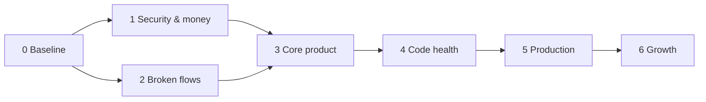

# Roadmap & Phase Tracker

Single source of truth for **what to do next**. Findings (the *why*) live in [docs/AUDIT.md](docs/AUDIT.md); every item here links to one.

## How to use this file

- Work top to bottom. Do not start a phase until the previous phase's **exit criteria** hold. Exception: Phase 0 → 1 → 2 items marked `Must` may run in parallel once Phase 0's test/CI baseline is green.
- One PR per checkbox (or a tight group with the same root cause). PR title carries the ID: `fix(invoices): quantize tax and totals (DATA-3)`.
- Tick the box in the same PR that closes it, add the PR link, and add a line to [CHANGELOG.md](CHANGELOG.md) under `Unreleased`.
- Every bug fix lands with a test that fails before the fix. Every `Must` item without a test is not done.
- Size: **S** < half a day · **M** 1–2 days · **L** 3+ days.

## Status

| Phase | Theme | Status | Done |
|---|---|---|---|
| 0 | Baseline: green tests, working CI, honest docs | ✅ Done (CI green on `main`, run 43703445329) | 11 / 11 |
| 1 | Security & money integrity | ✅ Done | 14 / 14 |
| 2 | Fix broken user flows | ✅ Done | 17 / 17 |
| 3 | Complete the core product (payments, currency, time billing) | 🟡 In progress | 6 / 8 |
| 4 | Code health, performance, UX & a11y | ⚪ Not started | 0 / 16 |
| 5 | Production readiness | ⚪ Not started | 0 / 11 |
| 6 | Growth features | ⚪ Not started | 0 / 9 |

---

## Phase 0 — Baseline

**Goal:** anyone can clone, run, test and get a green CI in under 15 minutes; the docs describe reality.

**Exit criteria:** `pytest` green · `npm run lint` and `npm run build` green · CI green on `main` · README quick start works from a fresh clone.

- [x] Remove junk: empty `FreelanceFlow/`, `Untitled` (Figma link moved to [docs/DESIGN.md](docs/DESIGN.md)), duplicate root `venv/`, `frontend/dist/`, `__pycache__/` — **S**
- [x] Merge the two `.env.example` files into the root one ([OPS-6](docs/AUDIT.md#ops-6)) — **S**
- [x] Replace the broken fixture with `python manage.py seed_demo` ([OPS-11](docs/AUDIT.md#ops-11)) — **S**
- [x] Rewrite README; add AUDIT, PHASES, AGENTS/CLAUDE, CONTRIBUTING, SECURITY, CHANGELOG, ADRs ([OPS-10](docs/AUDIT.md#ops-10)) — **S**
- [x] Track `backend/static/` (`.gitkeep`) so fresh clones pass Django's `staticfiles.W004` check — **S**
- [x] Add `config/settings/test.py` and point `pytest.ini` at it ([TEST-2](docs/AUDIT.md#test-2)) — **S**
- [x] Make the backend suite green: deleted all 7 dead-view tests (4 failing), fixed the other 5 ([TEST-1](docs/AUDIT.md#test-1)) — **S**
- [x] Fix CI: `working-directory: backend`, build `./backend`, add a frontend job ([OPS-1](docs/AUDIT.md#ops-1)) — **S**
- [x] Make lint pass: frontend `npm run lint`; backend one formatting-only commit (`black`/`isort`) + flake8 fixes ([OPS-2](docs/AUDIT.md#ops-2)) — **S**
- [x] Default Celery to local settings; anchor `.gitignore` `lib/` ([OPS-12](docs/AUDIT.md#ops-12), [OPS-13](docs/AUDIT.md#ops-13)) — **S**
- [x] Set up Vitest + React Testing Library + MSW with one passing test; add `npm test` to CI ([TEST-4](docs/AUDIT.md#test-4)) — **M**

## Phase 1 — Security & money integrity

**Goal:** no user can read or change another user's data, and every stored amount is correct to the cent.

**Exit criteria:** every item has a regression test · cross-tenant test suite covers every write endpoint · invoice totals property-tested (`subtotal - discount + tax == total` for random inputs).

- [x] Scope `client`/`invoice` querysets to `request.user` on every write serializer ([SEC-1](docs/AUDIT.md#sec-1)) — **S**
- [x] Production settings require `SECRET_KEY` and `ALLOWED_HOSTS`; add `SECURE_PROXY_SSL_HEADER` ([SEC-2](docs/AUDIT.md#sec-2)) — **S**
- [x] Validate logo uploads with Pillow; PNG/JPEG/WebP only; delete the old file ([SEC-3](docs/AUDIT.md#sec-3)) — **S**
- [x] Throttle auth endpoints; run password validators; lower-case emails; 400 on signup race ([SEC-4](docs/AUDIT.md#sec-4)) — **M**
- [x] Remove `django-debug-toolbar` from production requirements ([SEC-7](docs/AUDIT.md#sec-7)) — **S**
- [x] `default_currency` → `ChoiceField` ([SEC-8](docs/AUDIT.md#sec-8)) — **S**
- [x] `Invoice.client` → `PROTECT`; client delete returns 409 when invoices exist; UI archives instead ([DATA-1](docs/AUDIT.md#data-1)) — **M**
- [x] Make `status` read-only; enforce transitions in model methods; add a cancel endpoint ([DATA-2](docs/AUDIT.md#data-2)) — **M**
- [x] Quantize `line_total`, `tax_amount`, `total` (`ROUND_HALF_UP`) ([DATA-3](docs/AUDIT.md#data-3), backend half) — **S**
- [x] SPA shows server-computed money; integer-cent preview for unsaved drafts ([DATA-3](docs/AUDIT.md#data-3), frontend half) — **M**
- [x] Atomic invoice create/update; `bulk_create` items; one totals calculation; drop the per-item signal ([DATA-4](docs/AUDIT.md#data-4)) — **M**
- [x] Fractional quantities end-to-end; non-negative discount/tax; tax ≤ 100 ([DATA-5](docs/AUDIT.md#data-5)) — **S**
- [x] Editing a draft keeps its saved dates ([DATA-6](docs/AUDIT.md#data-6)) — **S**
- [x] Idempotent Stripe webhook with amount/status checks and `Decimal` amounts ([PAY-1](docs/AUDIT.md#pay-1)) — **M**

## Phase 2 — Fix broken user flows

**Goal:** every screen does what its label says, for a user with more than 20 records and a non-USD currency.

**Exit criteria:** manual QA script (login → client → invoice → send → mark paid → reports) passes with the `seed_demo` account switched to EUR · each fix has a backend or Vitest test.

- [x] Login errors show instead of reloading the page ([BUG-1](docs/AUDIT.md#bug-1)) — **S**
- [x] Client totals use the API's field names ([BUG-2](docs/AUDIT.md#bug-2)) — **S**
- [x] Time logs save without an explicit rate ([BUG-3](docs/AUDIT.md#bug-3)) — **S**
- [x] "Mark Paid" available on overdue invoices ([BUG-4](docs/AUDIT.md#bug-4)) — **S**
- [x] One `formatCurrency` everywhere, including all preview templates and emails ([BUG-5](docs/AUDIT.md#bug-5)) — **M**
- [x] Real password reset: email → `/reset-password/:uid/:token` → confirm endpoint ([BUG-6](docs/AUDIT.md#bug-6)) — **M**
- [x] Pagination controls, `page_size` param, totals over every row ([BUG-7](docs/AUDIT.md#bug-7)) — **M**
- [x] Only a 401 clears the session on page load ([BUG-8](docs/AUDIT.md#bug-8)) — **S**
- [x] Single send pipeline (mark sent → PDF → email); UI shows queued state; PDF regenerated on status change ([BUG-9](docs/AUDIT.md#bug-9)) — **M**
- [x] Delete only on drafts; show API error messages ([BUG-10](docs/AUDIT.md#bug-10)) — **S**
- [x] Client search filters on the backend ([BUG-11](docs/AUDIT.md#bug-11)) — **S**
- [x] `?client=` preselects the client on new invoices ([BUG-12](docs/AUDIT.md#bug-12)) — **S**
- [x] Date-only values parsed as local dates ([BUG-13](docs/AUDIT.md#bug-13)) — **S**
- [x] Reports: no `NaN%` ([BUG-14](docs/AUDIT.md#bug-14)) — **S**
- [x] Error + retry states; `Promise.allSettled` on the Dashboard ([BUG-15](docs/AUDIT.md#bug-15)) — **M**
- [x] PDF: "Due Date" label, receipt text only when paid, colour stored on the invoice ([BUG-16](docs/AUDIT.md#bug-16)) — **M**
- [x] Invalid query params return 400 ([BUG-17](docs/AUDIT.md#bug-17)) — **S**

## Phase 3 — Complete the core product

**Goal:** a freelancer can bill tracked time, send an invoice with a pay link, and get paid in full or in parts, in the invoice's own currency.

**Exit criteria:** Stripe test-mode payment from the emailed link marks the invoice paid (webhook replayed twice = one payment) · time logs → invoice round trip covered by tests.

- [x] Authenticated `POST /api/invoices/{id}/checkout/`; pay link created on send and shown in email + SPA ([PAY-2](docs/AUDIT.md#pay-2)) — **M**
- [x] Multiple/partial payments with `amount_due`; "Record payment" form ([PAY-3](docs/AUDIT.md#pay-3)) — **L**
- [x] Handle refunds and expired sessions ([PAY-4](docs/AUDIT.md#pay-4)) — **S**
- [x] `Invoice.currency` with data migration; used by PDF, emails, Stripe, SPA ([DATA-7](docs/AUDIT.md#data-7)) — **M**
- [x] Bill unbilled time logs onto a new or draft invoice ([FEAT-1](docs/AUDIT.md#feat-1)) — **M**
- [x] API: duplicate, cancel/void, re-send, manual reminder ([FEAT-2](docs/AUDIT.md#feat-2)) — **M**
- [ ] Public tokenized invoice page with Pay button ([FEAT-3](docs/AUDIT.md#feat-3)) — **L**
- [ ] Email tasks retry with backoff (`autoretry_for`, `retry_backoff`) ([OPS-9](docs/AUDIT.md#ops-9), part) — **S**

## Phase 4 — Code health, performance, UX & a11y

**Goal:** less code, current dependencies, fast first load, keyboard- and screen-reader-usable.

**Exit criteria:** Lighthouse accessibility ≥ 95 on Dashboard, Invoice list, Invoice create · initial JS chunk < 300 KB minified (812 KB today) · `makemigrations --check` clean · no unused deps.

- [ ] Delete the server-rendered UI, crispy, unused allauth URLs; move the webhook under `/api/` ([LEAN-1](docs/AUDIT.md#lean-1), [ADR-0001](docs/adr/0001-api-only-backend.md)) — **M**
- [ ] Remove unused dependencies ([LEAN-2](docs/AUDIT.md#lean-2)) — **S**
- [ ] Remove dead backend helpers ([LEAN-3](docs/AUDIT.md#lean-3)) — **S**
- [ ] Remove dead frontend code; one shared `formatCurrency`/`StatusBadge` ([LEAN-4](docs/AUDIT.md#lean-4)) — **S**
- [ ] Split `InvoicePreview` (one file per template), `InvoiceCreate`, `TimeTracker`, `Settings` by job ([LEAN-5](docs/AUDIT.md#lean-5)) — **M**
- [ ] Annotate client aggregates (61 → 2 queries per page) ([PERF-1](docs/AUDIT.md#perf-1)) — **S**
- [ ] Route-level code splitting ([PERF-2](docs/AUDIT.md#perf-2)) — **S**
- [ ] Upgrade to Django 5.2 LTS + `STORAGES`; pin with pip-tools; fix migration drift ([OPS-7](docs/AUDIT.md#ops-7)) — **M**
- [ ] ESLint 9 flat config, Prettier, pre-commit (ruff/black/isort/prettier), one Python version ([OPS-8](docs/AUDIT.md#ops-8)) — **S**
- [ ] Accessible Modal ([UX-1](docs/AUDIT.md#ux-1)) — **S**
- [ ] Labelled inputs, keyboard-reachable rows, named icon buttons ([UX-2](docs/AUDIT.md#ux-2)) — **S**
- [ ] 404 route ([UX-3](docs/AUDIT.md#ux-3)) — **S**
- [ ] Implement or remove fake settings/bell/plan card; define `xs` breakpoint ([UX-4](docs/AUDIT.md#ux-4)) — **S**
- [ ] One theme provider, persisted; correct logo per theme ([UX-5](docs/AUDIT.md#ux-5)) — **S**
- [x] Pick one product name and apply it everywhere ([UX-6](docs/AUDIT.md#ux-6)) — **S**
- [ ] Generate an OpenAPI schema (`drf-spectacular`), commit it, fail CI on drift; SPA field names checked against it (prevents [BUG-2](docs/AUDIT.md#bug-2)-style mismatches) — **M**
- [ ] PDF layouts match the six designs in the SPA preview (today the picker changes the preview only, [BUG-16](docs/AUDIT.md#bug-16)) — **L**

## Phase 5 — Production readiness

**Goal:** one command deploys a secure, observable stack that survives restarts and bad days.

**Exit criteria:** staging deploy from CI · TLS A grade · Sentry receives a test error from backend and SPA · Playwright smoke passes against staging · restore from backup rehearsed once.

- [ ] Fix prod compose: build `./backend`, serve the SPA from nginx, proxy `/api` `/admin` `/static` `/media`, TLS, migrate on release ([OPS-3](docs/AUDIT.md#ops-3)) — **M**
- [ ] `collectstatic` with production settings in the image ([OPS-4](docs/AUDIT.md#ops-4)) — **S**
- [ ] Multi-stage frontend image + `.dockerignore`; `VITE_API_URL` as build arg ([OPS-5](docs/AUDIT.md#ops-5)) — **S**
- [ ] PDFs with logos work on S3 ([BUG-18](docs/AUDIT.md#bug-18)) — **S**
- [ ] Signed, private S3 URLs ([SEC-6](docs/AUDIT.md#sec-6)) — **S**
- [ ] Session-cookie auth (or expiring tokens) per [ADR-0002](docs/adr/0002-auth-session-cookies.md) ([SEC-5](docs/AUDIT.md#sec-5)) — **M**
- [ ] Sentry (backend + SPA), structured logging, `/healthz` that checks DB and Redis ([OPS-9](docs/AUDIT.md#ops-9)) — **M**
- [ ] Playwright smoke test in CI ([TEST-5](docs/AUDIT.md#test-5)) — **M**
- [ ] Automated Postgres backups + documented restore — **S**
- [ ] Dependabot (pip, npm, actions, docker) + `pip-audit`/`npm audit` in CI — **S**
- [ ] Deploy pipeline: build images on `main`, push to registry, deploy to staging, manual promote to prod — **M**

## Phase 6 — Growth features

Pick by user demand; each needs a short spec in `docs/specs/` before work starts ([FEAT-4](docs/AUDIT.md#feat-4)).

- [ ] Recurring invoices (Celery Beat) — **L**
- [ ] Quotes/estimates → convert to invoice — **L**
- [ ] Credit notes / void with audit trail — **M**
- [ ] Activity timeline per invoice (created, sent, viewed, paid) — **M**
- [ ] CSV export for accounting (invoices, payments, time) — **S**
- [ ] Per-line tax, multiple tax rates, percentage discounts — **M**
- [ ] Per-user invoice number prefix/format — **S**
- [ ] Notification settings (reminder cadence, opt-out per client) — **M**
- [ ] Account data export & deletion (GDPR), email verification — **M**
