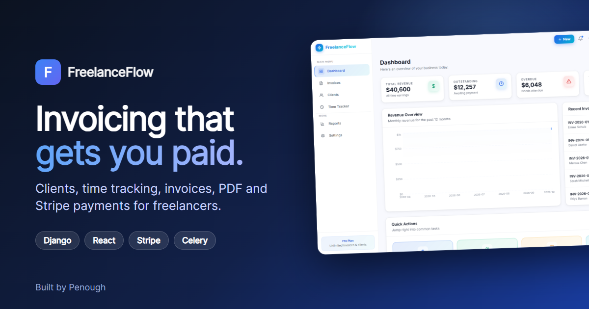
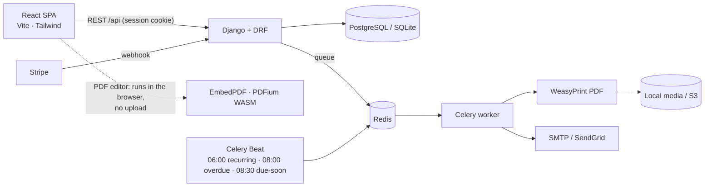
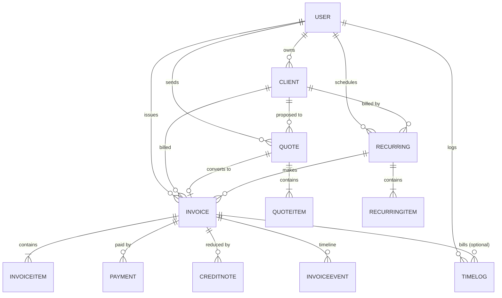

<h1 align="center">FreelanceFlow</h1>

<p align="center">
  
</p>

<p align="center">
  Invoicing for freelancers: quote the work, track time, send branded PDF invoices, collect Stripe payments, chase overdue invoices automatically, and edit any PDF in your browser.
</p>

<p align="center">
  
  
  
  
  
  
  
  
</p>

> [!NOTE]
> **Status: feature-complete; deployment is the last step.** Everything below runs from `runserver` + `npm run dev` and is covered by tests and a Playwright run in CI. Not yet done: running the production Docker stack for the first time, backups, a deploy pipeline, and one real Stripe test-mode payment (payments are tested against mocks only). Progress: **[PHASES.md](PHASES.md)**. Findings: **[docs/AUDIT.md](docs/AUDIT.md)**.

## Contents

- [What you can do](#what-you-can-do)
- [Features and what you get](#features-and-what-you-get)
- [Known limits](#known-limits)
- [Quick start](#quick-start)
- [Architecture](#architecture)
- [Project structure](#project-structure)
- [Development](#development)
- [Roadmap](#roadmap)
- [Documentation](#documentation)

## What you can do

FreelanceFlow follows the money from tracked work to cash in the bank, and adds a PDF editor for everything else you have to sign, mark up or fix.

| Stage | You | FreelanceFlow |
|---|---|---|
| Win the work | Send a priced proposal | Emails a quote with a PDF and a link; the client accepts or declines in one click; you turn it into an invoice |
| Do the work | Log hours | Timer and manual entries; bill them onto an invoice in two clicks |
| Bill | Write the invoice, or let a schedule do it | Six PDF layouts, per-line tax, discounts, your logo and bank details; recurring schedules make invoices for retainer clients |
| Get paid | Send it | The client opens a page with no account, downloads the PDF and pays by card; deposits and refunds are tracked |
| Chase | Do nothing | Due-soon and overdue reminders go out by themselves, with your cadence and per-client opt-outs |
| Correct | Fix a mistake | Credit notes and cancellations with a reason, never silent edits; a timeline shows what happened and when |
| Report | Ask "how am I doing?" | Revenue from money actually received, outstanding and overdue balances, a monthly chart, CSV for your accountant |
| Handle any PDF | Sign, annotate, redact, fill, edit | A PDF editor that runs in your browser; the file never leaves your device |

## Features and what you get

### Clients
- **What it does:** keeps a profile per client (name, company, email, address, phone, notes) with search.
- **What you get:** per-client totals for billed, paid and outstanding. Clients with invoices are archived, never deleted, so history and totals stay intact. An opt-out switch silences automatic reminders for one client.

### Invoices
- **What it does:** line items with fractional quantities, a per-invoice tax rate, optional per-line tax rates, and a fixed or percentage discount.
- **What you get:**
  - Numbers like `ACME-2026-001` with your own prefix, counted per year.
  - Every amount correct to the cent: totals are computed on the server and the live preview in the form matches them.
  - Statuses Draft, Sent, Overdue, Paid and Cancelled that change only through checked transitions.
  - Duplicate, send again, send a reminder, or cancel with a written reason.
  - One currency per invoice, frozen when it is created, so changing your default never rewrites old invoices.
  - Lines stay in the order you wrote them.
  - Several tax rates on one invoice print one tax row per rate, with the discount shared across rates before tax.

### PDF invoices
- **What you get:** a PDF with your logo, business and bank details, terms, status and due date. Choose one of six layouts and an accent colour; the emailed PDF is the same as the one you download. Receipts show "paid" only when it is true.

### Time tracking
- **What it does:** a timer and manual entries with an optional hourly rate.
- **What you get:** tick the entries and bill them onto a new draft invoice, or add them to an existing draft for the same client. Billed hours are marked and linked so nothing is billed twice.

### Sending and reminders
- **What it does:** one send pipeline: mark sent, render the PDF, email it with a pay link. Failed mail is retried with backoff.
- **What you get:**
  - A due-soon notice (you choose how many days before, or turn it off) and overdue notices (once, or repeated every N days).
  - A master switch for reminders and an opt-out per client.
  - The daily job never emails the same invoice twice in a day.
  - If the mail queue is down you get a clear "try again" instead of a hang.
  - Sending is limited to 60 emails an hour per account, and requires a confirmed email address.

### Getting paid
- **What it does:** Stripe Checkout from the app and from a public client page, `/pay/<token>`.
- **What you get:**
  - Your client needs no account: they see one invoice, download the PDF and pay by card.
  - Deposits and instalments, with the balance always shown. Record bank, cash or cheque payments by hand.
  - Refunds in Stripe are mirrored as negative payments and reopen the invoice.
  - The webhook is replay-safe: the same event twice records one payment. A payment session priced for an old balance is expired when the balance changes.

### Quotes
- **What it does:** a priced proposal with line items, tax, a discount and an expiry date.
- **What you get:** send it by email with a PDF and a link. The client accepts or declines on `/quote/<token>`, and an expired quote cannot be accepted. Convert it into a draft invoice with every line, tax rate and discount copied, once.

### Recurring invoices
- **What it does:** a schedule (weekly, monthly, quarterly or yearly) with its own line items.
- **What you get:** a daily job makes the invoice, either as a draft for review or emailed straight away. One invoice per run, even if the job repeats or the server was down. Months stay anchored to the start day (Jan 31, Feb 28, Mar 31). A schedule ends on its end date, or pauses itself if its client is archived. Pause, resume or delete any time; invoices already made stay.

### Credit notes and the activity timeline
- **What it does:** corrections without rewriting history.
- **What you get:**
  - Numbered `CN-2026-001` credit notes with a PDF. They lower what is owed; they cannot be edited or deleted.
  - A fully credited invoice settles by itself.
  - An invoice timeline: created, sent, viewed by the client, reminded, payments, refunds, credited, paid, overdue, cancelled, each with a time.

### Dashboard, reports and export
- **What you get:** revenue counted from money received (not invoices flagged paid), outstanding and overdue balances after deposits and credits, a monthly chart, and CSV export of invoices, payments and time logs for your accountant.

### PDF editor
- **What it does:** opens any PDF from your device and edits it in the browser. The file is never uploaded, and only signed-in users can open it.
- **What you get:**
  - **Mark up:** highlight, underline, strike out, sticky notes, text boxes, shapes, arrows, freehand drawing, comments.
  - **Add content:** images, stamps, and a signature you draw, type or upload.
  - **Forms:** fill in a form, or build one by placing text boxes, checkboxes, dropdowns and signature fields.
  - **Redact:** mark text or areas, then remove them from the file for good (not just covered).
  - **Edit text:** select text, type the replacement. The original is removed and the new text drawn in its place.
  - **Pages:** rotate, reorder, duplicate, insert and delete; add pages from other PDFs; crop.
  - **Finish:** watermark, page numbers, search, copy text, metadata, print and download.
  - **From your invoices:** "Edit PDF copy" on an invoice or quote opens a copy. The invoice saved in FreelanceFlow is never replaced.

### Your account and your data
- **What you get:**
  - Sign in with email and password; the session is an HttpOnly cookie with CSRF protection, and a password reset ends every other session.
  - Email confirmation before you can send to clients.
  - A business profile with logo, bank details and terms, and your own invoice number prefix.
  - **Export** everything you own as one JSON file.
  - **Delete your account:** your profile, drafts, time logs and stored PDFs are erased. Issued invoices, their payments and the clients they name are kept, because accounting records must be.

### Built to be trusted
- **Money:** `Decimal` end to end, rounded half-up to the cent. The same maths runs in the browser preview and on the server, and they are checked against each other.
- **Privacy:** every query is scoped to the signed-in user, including every field that points at another record; cross-user tests cover the write endpoints. Public pages show only what a client needs and are rate-limited.
- **Security:** throttled login, signup, password reset, sending and account deletion; signed, expiring email-verification links; private, signed file URLs in production; CSV formula injection defused.
- **Observability:** optional Sentry for the API and the app, JSON logs, a `/healthz/` check for the database and queue.
- **Accessibility:** the screens are checked with axe in light and dark themes; dialogs trap focus and close on Escape.

## Known limits

| Area | Limit |
|---|---|
| Payments | Only tested against mocks; no live Stripe run yet. The client page link is permanent and cannot be revoked |
| PDF editor | No paragraph reflow: replacement text longer than the original overlaps what follows. Existing images cannot be moved (remove with redaction, place again). Editing a signed PDF breaks its signature. Scanned pages stay images (no OCR yet). Watermark and page-number text is Latin only |
| Reports | Totals add different currencies together |
| Deployment | The production Docker stack is written but has not been run end to end |

## Quick start

**Prerequisites:** Python 3.12 (pinned in `.python-version`, Dockerfile and CI; 3.13 also works with Django 5.2), Node.js 20+. Redis is only needed for Celery (email/PDF/reminders). WeasyPrint needs Pango; on Windows install the [GTK runtime](https://doc.courtbouillon.org/weasyprint/stable/first_steps.html#windows).

```bash
git clone https://github.com/Ashfaq10/FreelanceFlow.git
cd freelanceflow
cp .env.example .env              # defaults use SQLite and print emails to the console

# Backend: http://localhost:8000
cd backend
python -m venv venv
venv\Scripts\activate             # macOS/Linux: source venv/bin/activate
pip install -r requirements-dev.txt
python manage.py migrate
python manage.py seed_demo        # demo account with realistic data (see below)
python manage.py runserver

# Frontend: http://localhost:3000 (new terminal)
cd frontend
npm install
npm run dev
```

Log in with **`demo@freelanceflow.dev` / `demo-pass-2026`**. The demo account has 6 clients (one archived), 19 invoices over the last 8 months in every status (paid, sent, overdue, draft, cancelled), 11 payments and 16 time logs. Re-create it any time with `python manage.py seed_demo --reset`. All demo client emails use `example.com`, so reminders can never reach a real person.

Optional background worker (needs Redis):

```bash
# backend/, with the venv active
celery -A config worker -l info --pool=solo           # --pool=solo is required on Windows
celery -A config beat -l info --scheduler django_celery_beat.schedulers:DatabaseScheduler
```

### Docker (development)

```bash
cp .env.example .env              # set USE_SQLITE=False and DB_HOST=db to use the compose Postgres
docker compose up --build
docker compose exec web python manage.py migrate
docker compose exec web python manage.py seed_demo
```

| Service | URL |
|---|---|
| React SPA | http://localhost:3000 |
| Django API | http://localhost:8000/api/ |
| Django admin | http://localhost:8000/admin/ (`python manage.py createsuperuser`) |

### Docker (production)

```bash
cp .env.prod.example .env.prod   # fill in secrets and your domain
docker compose -f docker-compose.prod.yml up -d --build
```

Caddy (the `proxy` service) serves the built SPA, proxies `/api`, `/admin` and `/static` to gunicorn, and gets a TLS certificate for `SITE_ADDRESS`. A one-shot `migrate` service runs before `web`, `celery` and `celery-beat` start. `GET /healthz/` checks the database and the Celery broker. **Not yet run end to end** (Docker was unavailable when it was written); CI builds both images.

## Architecture





All primary keys are UUIDs; money fields are `Decimal(10,2)`; every record is scoped to its owning user. Money maths lives in one module (`backend/apps/invoices/totals.py`) shared by invoices and quotes, mirrored by `frontend/src/utils/money.js`. The backend is API-only ([ADR-0001](docs/adr/0001-api-only-backend.md)); the PDF editor is browser-only ([ADR-0003](docs/adr/0003-pdf-editor-in-the-browser.md)).

## Project structure

```
freelanceflow/
├── backend/                  Django project (run commands from here)
│   ├── config/               settings/{base,local,production,test,e2e}.py, urls.py, celery.py, observability.py
│   ├── apps/
│   │   ├── accounts/         custom User, auth + verification + export/erasure API, `seed_demo` command
│   │   ├── clients/          Client CRUD API
│   │   ├── invoices/         Invoice + items, numbering, totals.py, credit notes, events, PDF, Celery tasks
│   │   ├── quotes/           Quote + items, send, public accept/decline, convert to invoice
│   │   ├── recurring/        RecurringInvoice schedules and the daily task
│   │   ├── payments/         Payment model, Stripe checkout and webhook
│   │   ├── time_tracker/     TimeLog API and billing
│   │   └── dashboard/        summary and chart aggregates, CSV exports
│   ├── templates/            invoice_pdf.html, credit_note_pdf.html, quote_pdf.html, email templates
│   └── tests/                pytest + factory_boy
├── frontend/                 React SPA
│   ├── src/{api,context,pages,components,hooks,utils}
│   │   └── pages/PdfEditor/  the browser-side PDF editor
│   └── e2e/                  Playwright flows and a sample PDF
├── docs/                     AUDIT.md, API.md, DESIGN.md, openapi.json, adr/, specs/
├── PLAN.md · BACKLOG.md      product boundaries · the short "now / next" queue
├── PHASES.md                 full roadmap and progress tracker
├── MEMORY.md · SESSIONS.md   lessons and decisions · session handoff log
├── AGENTS.md / CLAUDE.md     guide for AI agents and new contributors
├── .claude/                  agent rules (code style, security) and enforced permission denies
├── docker-compose.yml        dev stack: web, frontend, db, redis, celery, beat
├── docker-compose.prod.yml   production stack: Caddy, migrate, web, celery, beat, db, redis
└── .env.example              every setting, with local-friendly defaults
```

## Development

```bash
# everything CI runs, from the repo root
bash scripts/check.sh            # add --pg to run the backend tests against the compose Postgres

# backend/
pytest                           # config.settings.test, in-memory SQLite
pytest --cov=apps --cov-report=html
flake8 apps && black --check apps && isort --check-only apps

# frontend/
npm run lint && npm run format:check
npm test                         # Vitest + Testing Library + MSW
npm run build
npm run e2e                      # Playwright: sign up to paid invoice, quotes, PDF editor (needs Chrome or `npx playwright install chromium`)
```

Conventions, commit format and the definition of done are in [CONTRIBUTING.md](CONTRIBUTING.md). Rules that protect money and data (Decimal everywhere, per-user scoping, status transitions only through model methods) are in [AGENTS.md](AGENTS.md).

## Roadmap

The 2026-11-15 audit produced **72 findings**, grouped into phases. Each phase has exit criteria, and each item has an ID so every commit and PR traces back to its finding.

| Phase | Goal | Highlights |
|---|---|---|
| **0 · Baseline** ✅ | Green tests, working CI, honest docs | CI paths, lint, test settings, Vitest setup |
| **1 · Security & money** ✅ | No cross-user access; every amount correct to the cent | User-scoped serializers, required `SECRET_KEY`, upload validation, throttled auth, no cascade deletes, idempotent webhook |
| **2 · Broken flows** ✅ | Every screen does what its label says | Login errors, client totals, currency everywhere, real password reset, pagination, send pipeline |
| **3 · Core product** ✅ | Bill time, pay online, partial payments | Stripe checkout, pay link, per-invoice currency, time to invoice, public invoice page |
| **4 · Code health** ✅ | Less code, current deps, accessible | API-only backend, Django 5.2 LTS, code splitting, accessible forms, OpenAPI |
| **5 · Finish the product** ✅ | Hardened, observable app | Session-cookie auth, S3 signed URLs, Sentry and JSON logs, Playwright, `pip-audit` |
| **6 · Growth** ✅ | Features users ask for | CSV export, invoice prefix, timeline, credit notes, per-line tax, reminder settings, GDPR + verification, recurring invoices, quotes |
| **6b · PDF editor** ✅ | Edit any PDF in the browser | Annotate, sign, redact, forms, edit text, watermark, page numbers, merge, crop |
| **7 · Containers & deploy** | Secure stack that survives restarts | Run the prod compose, backups, deploy pipeline, one real Stripe payment |

Details, checkboxes and sizes: **[PHASES.md](PHASES.md)**.

## Documentation

| Document | Purpose |
|---|---|
| [PLAN.md](PLAN.md) | Vision, goals, non-goals, architectural boundaries |
| [BACKLOG.md](BACKLOG.md) | Now / next / later queue: what to pick up next |
| [PHASES.md](PHASES.md) | Full roadmap with exit criteria and progress |
| [MEMORY.md](MEMORY.md) | Small decisions, lessons learned, debugging recipes |
| [SESSIONS.md](SESSIONS.md) | Handoff log between sessions; open questions |
| [docs/AUDIT.md](docs/AUDIT.md) | Every finding: problem, location, fix, severity |
| [docs/openapi.json](docs/openapi.json) | Generated OpenAPI 3 schema (all endpoints); checked for drift in CI |
| [docs/API.md](docs/API.md) | REST endpoints, Celery tasks, known issues per endpoint |
| [docs/DESIGN.md](docs/DESIGN.md) | Figma source, UI conventions, open design decisions |
| [docs/adr/](docs/adr/) | Architecture decision records |
| [docs/specs/](docs/specs/) | One short spec per feature: behaviour, non-goals, tests |
| [AGENTS.md](AGENTS.md) · [CLAUDE.md](CLAUDE.md) | Commands, layout, invariants and gotchas for agents and new contributors |
| [CONTRIBUTING.md](CONTRIBUTING.md) | Workflow, commit format, definition of done |
| [.claude/rules/](.claude/rules/) | Code style and security rules for agents (enforced denies in `.claude/settings.json`) |
| [SECURITY.md](SECURITY.md) | Reporting vulnerabilities; known open security issues |
| [CHANGELOG.md](CHANGELOG.md) | Notable changes |

## License

MIT, see [LICENSE](LICENSE).
