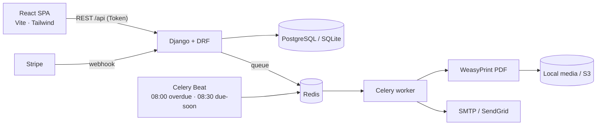
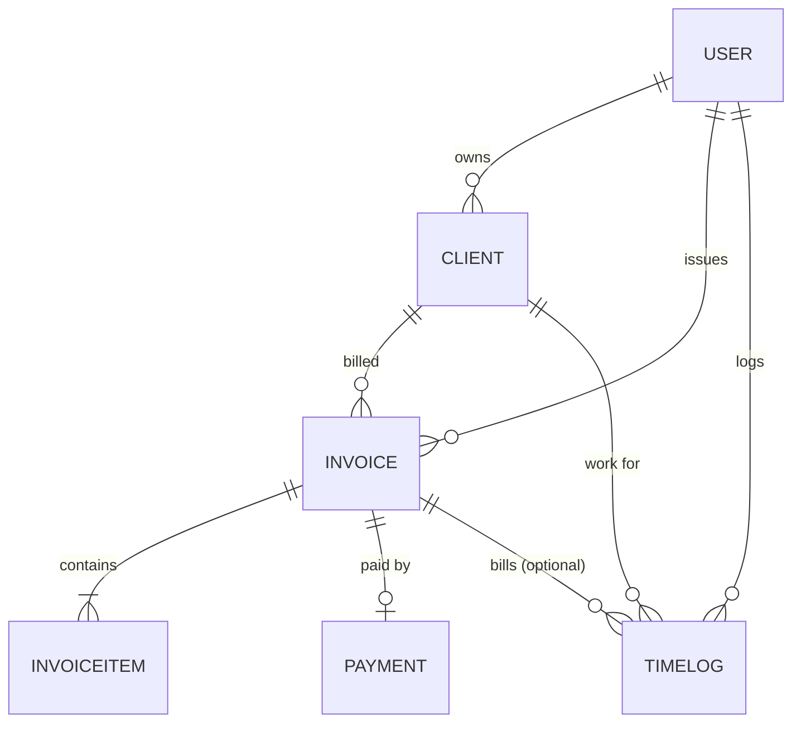

<h1 align="center">FreelanceFlow</h1>

<p align="center">
  Invoicing for freelancers: manage clients, track time, send branded PDF invoices, collect Stripe payments, and chase overdue invoices automatically.
</p>

<p align="center">
  
  
  
  
  
  
  
  
</p>

> [!WARNING]
> **Status: pre-release, under active hardening.** A full audit (2026-11-15) found security and money-integrity issues that must be fixed before any production use. Progress is tracked in **[PHASES.md](PHASES.md)**; findings are in **[docs/AUDIT.md](docs/AUDIT.md)**.

## Contents

- [Features](#features)
- [Quick start](#quick-start)
- [Architecture](#architecture)
- [Project structure](#project-structure)
- [Development](#development)
- [Roadmap: what we're fixing and why](#roadmap-what-were-fixing-and-why)
- [Documentation](#documentation)

## Features

| Area | What works today | Known gaps (audit ID) |
|---|---|---|
| **Invoices** | Line items, tax rate, flat discount, auto numbers (`INV-2026-001`), six preview templates, statuses Draft → Sent → Overdue → Paid / Cancelled | Totals not rounded explicitly ([DATA-3](docs/AUDIT.md#data-3)); whole-number quantities only ([DATA-5](docs/AUDIT.md#data-5)); editing resets dates ([DATA-6](docs/AUDIT.md#data-6)) |
| **Clients** | Profiles with address, notes, archive flag, per-client history | Totals show $0 ([BUG-2](docs/AUDIT.md#bug-2)); delete cascades to invoices ([DATA-1](docs/AUDIT.md#data-1)); search ignored ([BUG-11](docs/AUDIT.md#bug-11)) |
| **Time tracking** | Timer and manual entries per client with hourly rate | Rate required despite "optional" label ([BUG-3](docs/AUDIT.md#bug-3)); no "bill time to invoice" flow yet ([FEAT-1](docs/AUDIT.md#feat-1)) |
| **PDF** | WeasyPrint PDF with logo, business details, bank details, status | Logo breaks PDFs on S3 ([BUG-18](docs/AUDIT.md#bug-18)); template choice ignored ([BUG-16](docs/AUDIT.md#bug-16)) |
| **Email & reminders** | Send invoice with PDF; daily overdue marking; due-in-3-days and overdue reminders (Celery Beat) | Send is fire-and-forget ([BUG-9](docs/AUDIT.md#bug-9)); `$` hardcoded in emails ([BUG-5](docs/AUDIT.md#bug-5)) |
| **Payments** | Manual "mark paid"; Stripe webhook records payments | No way to create a Stripe pay link from the app yet ([PAY-2](docs/AUDIT.md#pay-2)); webhook not idempotent ([PAY-1](docs/AUDIT.md#pay-1)) |
| **Dashboard & reports** | Revenue, outstanding, overdue, paid vs. billed, monthly revenue chart | Only first 20 records considered in some views ([BUG-7](docs/AUDIT.md#bug-7)); `NaN%` for new users ([BUG-14](docs/AUDIT.md#bug-14)) |
| **Accounts** | Email + password signup/login, business profile, logo, currency | Password reset is a stub ([BUG-6](docs/AUDIT.md#bug-6)) |

## Quick start

**Prerequisites:** Python 3.12 (pinned in `.python-version`; Django 4.2 supports 3.8–3.12, so 3.13 is not supported yet), Node.js 20+. Redis is only needed for Celery (email/PDF/reminders). WeasyPrint needs Pango; on Windows install the [GTK runtime](https://doc.courtbouillon.org/weasyprint/stable/first_steps.html#windows).

```bash
git clone https://github.com/<you>/freelanceflow.git
cd freelanceflow
cp .env.example .env              # defaults use SQLite and print emails to the console

# Backend: http://localhost:8000
cd backend
python -m venv venv
venv\Scripts\activate             # macOS/Linux: source venv/bin/activate
pip install -r requirements-dev.txt
python manage.py migrate
python manage.py seed_demo        # demo account with realistic data (see below)
python manage.py runserver

# Frontend: http://localhost:3000 (new terminal)
cd frontend
npm install
npm run dev
```

Log in with **`demo@freelanceflow.dev` / `demo-pass-2026`**. The demo account has 6 clients (one archived), 19 invoices over the last 8 months in every status (paid, sent, overdue, draft, cancelled), 11 payments and 16 time logs. Re-create it any time with `python manage.py seed_demo --reset`. All demo client emails use `example.com`, so reminders can never reach a real person.

Optional background worker (needs Redis):

```bash
# backend/, with the venv active
celery -A config worker -l info --pool=solo           # --pool=solo is required on Windows
celery -A config beat -l info --scheduler django_celery_beat.schedulers:DatabaseScheduler
```

### Docker (development)

```bash
cp .env.example .env              # set USE_SQLITE=False and DB_HOST=db to use the compose Postgres
docker compose up --build
docker compose exec web python manage.py migrate
docker compose exec web python manage.py seed_demo
```

| Service | URL |
|---|---|
| React SPA | http://localhost:3000 |
| Django API | http://localhost:8000/api/ |
| Django admin | http://localhost:8000/admin/ (`python manage.py createsuperuser`) |

`docker-compose.prod.yml` does not deploy the app correctly yet ([OPS-3](docs/AUDIT.md#ops-3), Phase 5).

## Architecture





All primary keys are UUIDs; money fields are `Decimal(10,2)`; every record is scoped to its owning user. The backend also contains server-rendered Django views whose templates don't exist; they are dead code scheduled for removal ([ADR-0001](docs/adr/0001-api-only-backend.md)).

## Project structure

```
freelanceflow/
├── backend/                  Django project (run commands from here)
│   ├── config/               settings/{base,local,production}.py, urls.py, celery.py
│   ├── apps/
│   │   ├── accounts/         custom User, auth API, `seed_demo` command
│   │   ├── clients/          Client CRUD API
│   │   ├── invoices/         Invoice + items, numbering, totals, PDF, Celery tasks
│   │   ├── payments/         Payment model, Stripe webhook
│   │   ├── time_tracker/     TimeLog API
│   │   └── dashboard/        summary and chart aggregates
│   ├── templates/invoices/   invoice_pdf.html + email templates
│   └── tests/                pytest + factory_boy
├── frontend/                 React SPA
│   └── src/{api,context,pages,components,hooks,utils}
├── docs/                     AUDIT.md, API.md, DESIGN.md, adr/
├── PLAN.md · BACKLOG.md      product boundaries · the short "now / next" queue
├── PHASES.md                 full roadmap and progress tracker
├── MEMORY.md · SESSIONS.md   lessons and decisions · session handoff log
├── AGENTS.md / CLAUDE.md     guide for AI agents and new contributors
├── .claude/                  agent rules (code style, security) and enforced permission denies
├── docker-compose.yml        dev stack: web, frontend, db, redis, celery, beat
└── .env.example              every setting, with local-friendly defaults
```

## Development

```bash
# backend/
pytest                                   # tests (config.settings.test, in-memory SQLite)
pytest --cov=apps --cov-report=html      # coverage
flake8 apps && black --check apps && isort --check-only apps

# frontend/
npm run lint
npm test                                 # Vitest
npm run build
```

Conventions, commit format and the definition of done are in [CONTRIBUTING.md](CONTRIBUTING.md). Rules that protect money and data (Decimal everywhere, per-user scoping, status transitions only through model methods) are in [AGENTS.md](AGENTS.md#rules-that-protect-money-and-data).

## Roadmap: what we're fixing and why

The 2026-11-15 audit produced **72 findings**: 8 security, 7 data/money, 4 payments, 18 broken-flow bugs, and 35 covering features, performance, lean code, UX/accessibility, tests and ops. They are grouped into phases. Each phase has exit criteria, and each item has an ID so every commit and PR can be traced back to its finding.

| Phase | Goal | Highlights |
|---|---|---|
| **0 · Baseline** | Green tests, working CI, honest docs | Fix 9 failing tests, CI paths, frontend lint; test settings; Vitest setup |
| **1 · Security & money** | No cross-user access; every amount correct to the cent | Scope serializers to the user, require `SECRET_KEY`, validate uploads, throttle auth, protect invoices from cascade delete, lock status transitions, quantize money, atomic writes, idempotent Stripe webhook |
| **2 · Broken flows** | Every screen does what its label says | Login errors, client totals, currency everywhere, real password reset, pagination, send pipeline, date handling |
| **3 · Core product** | Bill time, pay online, partial payments | Stripe checkout from the app, pay link in emails, per-invoice currency, time → invoice, public invoice page |
| **4 · Code health** | Less code, current deps, accessible | Delete dead server-rendered UI (~1,000 lines), Django 5.2 LTS, N+1 fixes, code splitting, accessible modal/forms, one brand name |
| **5 · Production** | Secure, observable deploy | Working prod compose + TLS, session-cookie auth, signed S3 URLs, Sentry, backups, Playwright smoke test |
| **6 · Growth** | Features users ask for | Recurring invoices, quotes, credit notes, CSV export, multi-tax |

Details, checkboxes and sizes: **[PHASES.md](PHASES.md)**.

## Documentation

| Document | Purpose |
|---|---|
| [PLAN.md](PLAN.md) | Vision, goals, non-goals, architectural boundaries |
| [BACKLOG.md](BACKLOG.md) | Now / next / later queue: what to pick up next |
| [PHASES.md](PHASES.md) | Full roadmap with exit criteria and progress |
| [MEMORY.md](MEMORY.md) | Small decisions, lessons learned, debugging recipes |
| [SESSIONS.md](SESSIONS.md) | Handoff log between sessions; open questions |
| [docs/AUDIT.md](docs/AUDIT.md) | Every finding: problem, location, fix, severity |
| [docs/API.md](docs/API.md) | REST endpoints, Celery tasks, known issues per endpoint |
| [docs/DESIGN.md](docs/DESIGN.md) | Figma source, UI conventions, open design decisions |
| [docs/adr/](docs/adr/) | Architecture decision records |
| [AGENTS.md](AGENTS.md) · [CLAUDE.md](CLAUDE.md) | Commands, layout, invariants and gotchas for agents and new contributors |
| [CONTRIBUTING.md](CONTRIBUTING.md) | Workflow, commit format, definition of done |
| [.claude/rules/](.claude/rules/) | Code style and security rules for agents (enforced denies in `.claude/settings.json`) |
| [SECURITY.md](SECURITY.md) | Reporting vulnerabilities; known open security issues |
| [CHANGELOG.md](CHANGELOG.md) | Notable changes |

## License

MIT, see [LICENSE](LICENSE).
